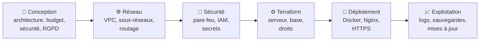
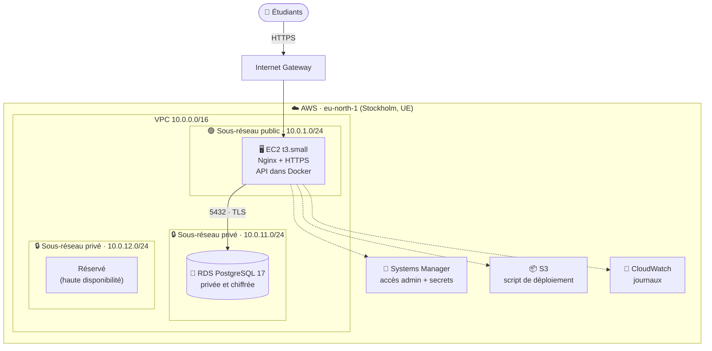
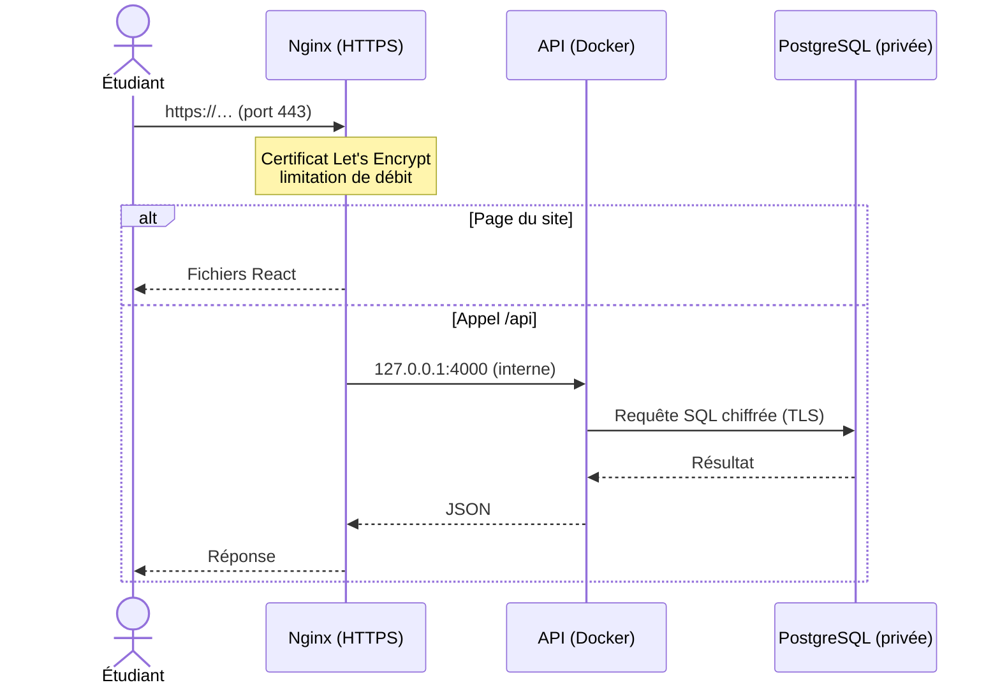
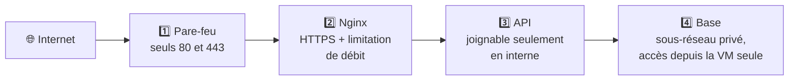
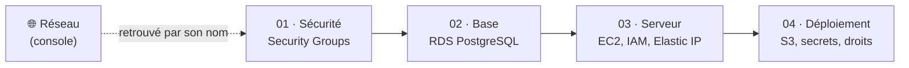
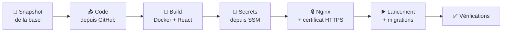

<div align="center">

# 🌱 GreenCampus HdF

### L'application qui aide les étudiants à mesurer et réduire leur empreinte carbone
### Infrastructure cloud conçue, déployée et sécurisée sur AWS

[](https://13-63-106-251.sslip.io)


</div>

---

## 🌍 Le projet

**GreenCampus HdF** est une application web destinée aux étudiants des Hauts-de-France. Elle leur permet de :

| | Fonctionnalité |
|---|---|
| 🧮 | **Calculer leur bilan carbone** en quelques minutes, à partir du modèle *Nos Gestes Climat* de l'ADEME |
| 🎯 | **Relever des défis hebdomadaires** pour réduire concrètement leur impact (transport, alimentation, numérique…) |
| 📊 | **Suivre un tableau de bord collectif** : l'impact de toute la communauté étudiante, de façon anonyme |
| 📅 | **Découvrir les événements** écologiques du campus |
| 🔔 | **Recevoir des notifications** pour ne pas rater un défi |

### Pourquoi c'est important

Le climat est l'affaire de tous, mais **on ne réduit bien que ce que l'on mesure**. Les étudiants veulent agir sans toujours savoir par où commencer : GreenCampus transforme un sujet abstrait en chiffres concrets et en petites actions faciles à tenir.

Le projet a aussi été pensé **respectueux de la vie privée** : **aucun compte, aucune donnée personnelle**. Les résultats collectifs sont anonymes, et toute l'infrastructure est hébergée **dans l'Union européenne**.

---

## 👨‍💻 Mon rôle : l'ingénieur cloud de l'équipe

> Mes coéquipiers ont développé l'application (API Node.js et front React).
> **J'ai conçu, construit, sécurisé et déployé toute l'infrastructure qui la fait tourner en production sur AWS.**



---

## 🏗️ Architecture



### Le chemin d'une requête



### Le réseau en détail

| Élément | Valeur | Rôle |
|---|---|---|
| **VPC** | `10.0.0.0/16` | Réseau privé et isolé du projet |
| **Sous-réseau public** | `10.0.1.0/24` · zone a | Le serveur, seule porte d'entrée depuis Internet |
| **Sous-réseau privé A** | `10.0.11.0/24` · zone a | La base de données |
| **Sous-réseau privé B** | `10.0.12.0/24` · zone b | Exigé par RDS (2 zones), prêt pour la haute disponibilité |
| **Table de routage publique** | `0.0.0.0/0 → Internet Gateway` | Le serveur peut joindre Internet |
| **Table de routage privée** | `local` uniquement | **La base n'a aucune route vers Internet** |

---

## 🔐 Sécurité

La sécurité est construite **en couches** : même si une protection tombe, les autres tiennent.



| Mesure | Ce que ça apporte |
|---|---|
| 🚫 **Aucun port SSH ouvert** | L'administration passe par **AWS Session Manager** : pas de clé à voler, chaque accès est tracé |
| 🧱 **Security Groups chaînés** | La base accepte **uniquement** le groupe du serveur, pas une adresse IP |
| 🔑 **Secrets dans SSM Parameter Store** | Chiffrés, jamais dans Git ni dans l'image Docker |
| 👤 **IAM au moindre privilège** | Le serveur ne lit que *ses* secrets, *son* bucket, et n'écrit que *ses* journaux |
| 🔒 **Chiffrement partout** | HTTPS pour les visiteurs, TLS vers la base, disques et base chiffrés au repos |
| 🛡️ **IMDSv2 obligatoire** | Protège les identifiants du serveur contre les attaques de type SSRF |

---

## 🧩 Infrastructure as Code

Le réseau a d'abord été construit **à la main dans la console**, pour comprendre chaque brique. Tout le reste est décrit en **Terraform**, découpé en **4 étapes indépendantes** :



```bash
cd infra/01-security   && terraform init && terraform apply
cd ../02-rds           && terraform init && terraform apply
cd ../03-vm            && terraform init && terraform apply
cd ../04-deploiement   && terraform init && terraform apply
```

> Les fichiers `terraform.tfstate` contiennent des secrets : ils restent en local et ne sont **jamais** envoyés sur Git.

---

## 🚀 Déploiement

Un **script unique et relançable** installe l'application ou la met à jour, en une commande, depuis Session Manager :



Le certificat HTTPS **se renouvelle tout seul**, l'API **redémarre seule** en cas de crash, et **un snapshot de la base est pris avant chaque mise à jour** pour pouvoir revenir en arrière.

---

## 🎓 Compétences mises en œuvre

| Domaine | Ce que j'ai fait concrètement |
|---|---|
| ☁️ **Cloud AWS** | VPC, sous-réseaux, Internet Gateway, EC2, Elastic IP, RDS, S3, IAM, Systems Manager, CloudWatch |
| 🌐 **Réseau** | Découpage CIDR, sous-réseaux public/privé, tables de routage, répartition sur 2 zones de disponibilité |
| 🔐 **Sécurité** | Pare-feu par Security Groups, moindre privilège IAM, gestion des secrets, chiffrement, aucun SSH |
| 🧩 **Infrastructure as Code** | Terraform modulaire en 4 étapes, data sources, remote state, génération de mot de passe |
| 🐳 **Conteneurs et serveur web** | Docker, Nginx en reverse proxy, HTTPS Let's Encrypt avec renouvellement automatique |
| 🐧 **Linux et scripting** | Amazon Linux 2023, Bash, systemd, swap, rotation des journaux |
| 🚀 **Mise en production** | Script de déploiement idempotent, migrations, mises à jour sans perte de données, tests après déploiement |
| 📈 **Exploitation** | Journaux centralisés (30 jours), snapshots, diagnostic et correction en production |
| ⚖️ **RGPD** | Hébergement dans l'UE, conservation limitée des journaux, plan de suppression en fin de projet |
| 💰 **Maîtrise des coûts** | Architecture dimensionnée pour un budget de 100 $ : choix argumentés (pas de load balancer ni de NAT) |
| 🤝 **Travail en équipe** | Échanges avec les développeurs, déploiement de leurs mises à jour, documentation |

### Des choix argumentés

| Décision | Pourquoi |
|---|---|
| **Pas de load balancer ni de NAT Gateway** | ~55 $/mois à eux deux, soit plus de la moitié du budget. L'API garde un état en mémoire : une seule instance est de toute façon nécessaire. |
| **Serveur public, base privée** | La base n'a jamais besoin d'Internet ; le serveur, si (certificat, notifications, mises à jour). |
| **Session Manager plutôt que SSH** | Zéro port d'administration exposé, accès tracés par IAM. |
| **Région Stockholm** | Dans l'UE pour le RGPD. |

---

## ✅ Résultats

<div align="center">

| 🌐 En ligne | 🔒 HTTPS | 🚫 Port SSH | 💰 Coût | 🇪🇺 Données |
|:---:|:---:|:---:|:---:|:---:|
| **En production** | **Let's Encrypt** | **0 ouvert** | **~40 $/mois** | **100 % UE** |

</div>


---

## 🔭 Et ensuite ?

- [ ] Réseau aussi en Terraform, avec un state distant sur S3
- [ ] CI/CD avec GitHub Actions (authentification OIDC, sans clé)
- [ ] Serveurs en sous-réseau privé derrière un load balancer, avec plusieurs instances
- [ ] Base en Multi-AZ et sauvegardes sur 7 jours
- [ ] WAF et alarmes CloudWatch

---

<div align="center">

**Infrastructure : Mahdi FAHS** · [Portfolio](https://mahdifahs.github.io/mahdifahs/)

*Application développée en équipe · code de l'API dans [`backend/`](backend/), du front dans [`frontend/`](frontend/)*

</div>
