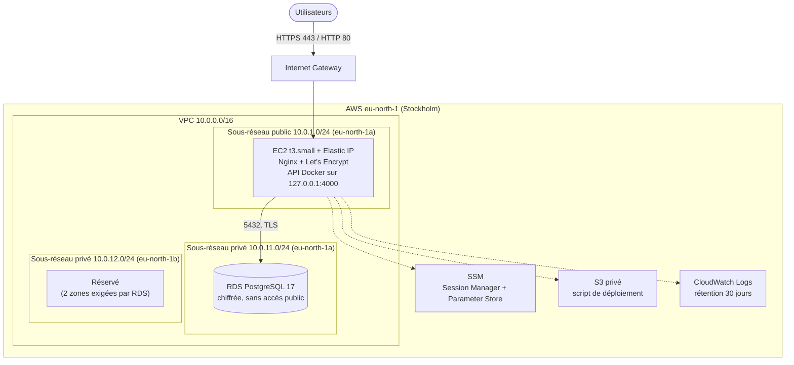

# GreenCampus HdF : infrastructure AWS

Conception, déploiement et exploitation de l'infrastructure cloud de **GreenCampus HdF**, une application web étudiante de bilan carbone (projet universitaire en équipe).

> **Mon rôle : l'infrastructure.** Réseau, sécurité, base de données, serveur, déploiement et exploitation sur AWS.
> L'application (API Node.js et front React) a été développée par mes coéquipiers.

**Site en ligne :** https://13-63-106-251.sslip.io

---

## En bref

| | |
|---|---|
| **Cloud** | AWS, région **eu-north-1 (Stockholm)**, dans l'UE pour le RGPD |
| **Réseau** | 1 VPC, 3 sous-réseaux (1 public, 2 privés), Internet Gateway, 2 tables de routage |
| **Calcul** | 1 VM EC2 `t3.small` (Amazon Linux 2023) avec Elastic IP |
| **Données** | RDS PostgreSQL 17, privée, chiffrée, sauvegardes automatiques |
| **Sécurité** | Security Groups chaînés, **aucun port SSH ouvert** (accès par SSM), secrets dans SSM Parameter Store, HTTPS Let's Encrypt |
| **Automatisation** | **Terraform** en 4 étapes, script de déploiement relançable |
| **Exploitation** | Logs CloudWatch (30 jours), snapshot de la base avant chaque mise à jour |

---

## Architecture



### Réseau

| Élément | Valeur | Rôle |
|---|---|---|
| VPC | `10.0.0.0/16` | Réseau isolé du projet |
| Sous-réseau public | `10.0.1.0/24`, eu-north-1a | La VM, seule ressource joignable depuis Internet |
| Sous-réseau privé A | `10.0.11.0/24`, eu-north-1a | La base RDS |
| Sous-réseau privé B | `10.0.12.0/24`, eu-north-1b | Exigé par RDS (2 zones minimum), réservé à un futur Multi-AZ |
| Internet Gateway | attachée au VPC | Entrée et sortie Internet du sous-réseau public |
| Table de routage publique | `0.0.0.0/0 → IGW` | Associée au sous-réseau public |
| Table de routage privée | `local` uniquement | Associée aux 2 sous-réseaux privés : **la base n'a aucune route vers Internet** |

### Pare-feu (Security Groups)

| Groupe | Entrée autorisée | Source |
|---|---|---|
| `gc-sg-vm` | 80 (HTTP), 443 (HTTPS) | `0.0.0.0/0` |
| `gc-sg-rds` | 5432 (PostgreSQL) | **`gc-sg-vm` uniquement** (référence de groupe, pas d'IP) |

Aucune règle pour le port 22 : l'administration de la VM passe par **AWS Systems Manager Session Manager**.

---

## Choix techniques

| Décision | Pourquoi |
|---|---|
| **Pas de load balancer ni de NAT Gateway** | Environ 55 $/mois à eux deux, plus de la moitié du budget (100 $ de crédits). Une seule VM suffit : l'API garde un état en mémoire et doit tourner en une seule instance. |
| **VM en sous-réseau public, base en privé** | Sans NAT, la VM sort par l'Internet Gateway (Let's Encrypt, notifications push, mises à jour). La base, elle, n'a jamais besoin d'Internet. |
| **Session Manager au lieu de SSH** | Aucun port d'administration exposé, accès tracé par IAM, pas de clé SSH à gérer. |
| **Secrets dans SSM Parameter Store (`SecureString`)** | Aucun secret dans Git ni dans l'image Docker. Le fichier d'environnement est régénéré sur la VM avec des droits `600`. |
| **API liée à `127.0.0.1:4000`** | Seul Nginx peut la joindre : impossible de contourner le reverse proxy et sa limitation de débit. |
| **Stockholm (eu-north-1)** | Région imposée au projet, dans l'UE (RGPD). |
| **Réseau créé à la console, le reste en Terraform** | Le réseau a été construit à la main pour bien maîtriser chaque brique. Terraform le retrouve ensuite par son nom (`data sources`) et gère tout le reste. |

---

## Infrastructure as Code (Terraform)

L'infrastructure est découpée en 4 étapes indépendantes, chacune lancée en une commande :

```bash
cd infra/01-security    && terraform init && terraform apply   # Security Groups
cd ../02-rds            && terraform init && terraform apply   # Base PostgreSQL 17
cd ../03-vm             && terraform init && terraform apply   # VM, rôle IAM SSM, Elastic IP
cd ../04-deploiement    && terraform init && terraform apply   # Bucket S3, droits de la VM, secrets
```

| Étape | Ressources créées |
|---|---|
| `01-security` | `gc-sg-vm`, `gc-sg-rds` |
| `02-rds` | DB subnet group, mot de passe généré (`random_password`), instance RDS `db.t4g.micro`, chiffrée, sans accès public |
| `03-vm` | Rôle IAM + profil d'instance (`AmazonSSMManagedInstanceCore`), EC2 Amazon Linux 2023 (disque chiffré, **IMDSv2 obligatoire**), Elastic IP, installation de Docker au premier démarrage |
| `04-deploiement` | Bucket S3 privé, politique IAM au moindre privilège pour la VM (lecture des secrets `/greencampus/prod/*`, du bucket, écriture des logs), paramètres `SecureString` de production |

Les fichiers d'état (`terraform.tfstate`) contiennent le mot de passe de la base : ils restent en local et sont exclus de Git.

---

## Déploiement de l'application

Un script de déploiement installe et met à jour l'application sur la VM. Il se lance depuis Session Manager, et la même commande sert aux mises à jour :

```bash
sudo aws s3 cp s3://<bucket>/deploy-vm.sh /tmp/ && sudo bash /tmp/deploy-vm.sh
```

1. Installe Docker, Nginx et Git, ajoute 2 Go de swap pour la compilation
2. Récupère le code depuis ce dépôt
3. Construit l'image Docker de l'API et le front React
4. Configure Nginx, obtient le **certificat HTTPS Let's Encrypt** et programme son renouvellement (minuteur systemd)
5. Récupère les secrets depuis SSM Parameter Store et génère les clés de notification push
6. Lance l'API (redémarrage automatique, logs envoyés à CloudWatch) : les migrations de base s'appliquent au démarrage

**Avant chaque mise à jour**, un snapshot manuel de la base est pris :

```bash
aws rds create-db-snapshot --db-instance-identifier gc-db --db-snapshot-identifier gc-db-avant-maj-<date>
```

---

## Vérifications après mise en ligne

| Test | Résultat attendu | Statut |
|---|---|---|
| Site en HTTPS | `HTTP/2 200` | ✅ |
| `/health` (API et base) | `{"status":"ok","base":"ok"}` | ✅ |
| HTTP | Redirection `301` vers HTTPS | ✅ |
| Données de base (seed) | Liste des filières renvoyée | ✅ |
| Routes de développement | `404` en production | ✅ |
| Port 4000 depuis Internet | Fermé | ✅ |
| VM joignable par SSM |
